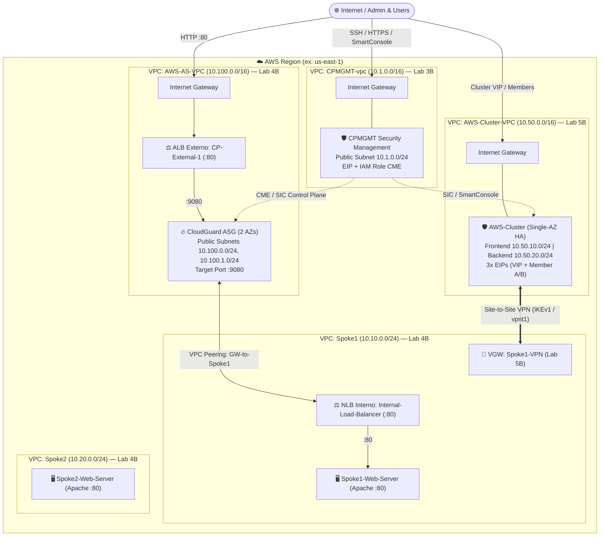

# Check Point Certified Cloud Specialist (CCCS R81.20) — AWS Lab em Terraform

Infraestrutura como Código (IaC) em **Terraform** para provisionamento automatizado na AWS da topologia completa do curso **Check Point Certified Cloud Specialist (CCCS R81.20)** — cobrindo os **Labs 3B, 4B, 5B, 6B e 8A** com os módulos oficiais da Check Point (`CheckPointSW/cloudguard-network-security/aws`), além de um módulo opcional de **Diagram as Code** para visualização da topologia.

---

## Sumário

- [Visão Geral da Arquitetura](#visão-geral-da-arquitetura)
- [Estrutura do Repositório](#estrutura-do-repositório)
- [Detalhamento dos Laboratórios](#detalhamento-dos-laboratórios)
- [Pré-requisitos](#pré-requisitos)
- [Como fazer o Deploy (Quick Start)](#como-fazer-o-deploy-quick-start)
- [Deploy Modular (Feature Flags)](#deploy-modular-feature-flags)
- [Diagram as Code (Módulo Opcional)](#diagram-as-code-módulo-opcional)
- [Outputs e Passos Pós-Deploy](#outputs-e-passos-pós-deploy)
- [Segurança e Limpeza](#segurança-e-limpeza)

---

## Visão Geral da Arquitetura



---

## Estrutura do Repositório

| Arquivo / Diretório | Descrição |
| :--- | :--- |
| `versions.tf` | Versão mínima do Terraform (`>= 1.3.0`), providers (`aws`, `http`, `random`, `tls`, `local`, `null`) e `default_tags`. |
| `variables.tf` | Declaração de todas as variáveis, feature flags, CIDRs, tipos de instância e credenciais. |
| `terraform.tfvars.example` | Modelo comentado de variáveis para copiar para `terraform.tfvars`. |
| `keypair.tf` | Criação opcional do SSH Key Pair (`create_key_pair = true`) salvando `<key_name>.pem` localmente. |
| `lab3b_management.tf` | **Lab 3B**: VPC `CPMGMT-vpc`, IGW, Security Management Server (`CPMGMT`), IAM Role CME e bootstrap opcional (`autoprov_cfg` + política). |
| `lab4b_autoscale.tf` | **Lab 4B**: VPCs `Spoke1`/`Spoke2`, Web Servers Apache, `AWS-AS-VPC`, CloudGuard ASG, ALB Externo, NLB Interno e VPC Peering `GW-to-Spoke1`. |
| `lab5b_cluster_vpn.tf` | **Lab 5B**: `AWS-Cluster-VPC`, CloudGuard Single-AZ HA Cluster, VGW, Customer Gateway, Site-to-Site VPN estática e bootstrap opcional de VTI (`vpnt1`). |
| `diagram.tf` | Integração opcional com o módulo local `modules/diagram_as_code`. |
| `outputs.tf` | Outputs consolidados com IPs públicos/privados, URLs de teste, comandos SSH e comandos Clish. |
| `modules/diagram_as_code/` | Módulo local opcional de **Diagram as Code** (Mermaid + script Python `diagrams`). |

---

## Detalhamento dos Laboratórios

### 1. Lab 3B — Security Management Server (`lab3b_management.tf`)
- **Key Pair (`keypair.tf`)**: Gera automaticamente o par de chaves e salva `<key_name>.pem` localmente (quando `create_key_pair = true`), ou reutiliza um Key Pair existente na AWS.
- **VPC `CPMGMT-vpc` (`10.1.0.0/16`)**: Subnet pública (`10.1.0.0/24`), Internet Gateway e Route Table.
- **Security Management Server (`CPMGMT`)**: Provisionado via módulo oficial Check Point (`R82.20-BYOL` por padrão, configurável via `management_version`), Elastic IP associado e **IAM Role do CME** com permissões Read-Write (Task 3B-3).
- **Automação CME & Access Policy (Tasks 3B-4 & 3B-5)**: Quando `auto_configure_cme_and_policy = true`, cria automaticamente o pacote de política `AWS-Scale-Policy` (Accept + Log) e inicializa o **Cloud Management Extension (`autoprov_cfg`)** apontando para o template `AWS-Scale-Lab-Template`.

### 2. Lab 4B — AWS EC2 Auto Scaling & Spoke VPCs (`lab4b_autoscale.tf`)
- **Spoke VPCs (Task 4B-1)**:
  - `Spoke1` (`10.10.0.0/24`) com subnet `Spoke1-subnet` e Security Group `Open`.
  - `Spoke2` (`10.20.0.0/24`) com subnet `Spoke2-subnet` e Security Group `Open`.
- **Web Servers (Task 4B-2)**: Instâncias `t3.micro` (`Spoke1-Web-Server` e `Spoke2-Web-Server`) com Apache HTTP pré-configurado (sem necessidade de acesso à internet nas subnets isoladas) e usuário `bitnami` para compatibilidade com a Task 5B-9.
- **Auto Scale VPC (`AWS-AS-VPC` — Task 4B-3)**: CIDR `10.100.0.0/16` em 2 Availability Zones, com 2 subnets públicas (`10.100.0.0/24`, `10.100.1.0/24`), 2 subnets privadas (`10.100.2.0/24`, `10.100.3.0/24`) e Internet Gateway.
- **CloudGuard Auto Scale Group (Task 4B-4)**: Gateways (`c7i-flex.large` por padrão, configurável via `asg_gateway_instance_type`, `asg_min_size` e `asg_max_size`), tagueados com `x-chkp-tags` para descoberta automática pelo CME.
- **Load Balancers (Task 4B-5)**:
  - **ALB Externo (`CP-External-1`)**: Internet-facing na porta `HTTP :80` encaminhando para o Target Group `External-Target-Group` na porta `:9080` dos Gateways do ASG.
  - **NLB Interno (`Internal-Load-Balancer`)**: No `Spoke1` na porta `TCP :80` encaminhando para `Spoke1-Web-Server`, tagueado com `x-chkp-management` e `x-chkp-template` para criação automática de regras de NAT/Access pelo CME.
- **VPC Peering & Routing (Tasks 4B-6 & 4B-7)**: Peering `GW-to-Spoke1` entre `AWS-AS-VPC` e `Spoke1` com rotas bidirecionais configuradas.

### 3. Lab 5B — CloudGuard Cluster & AWS Site-to-Site VPN (`lab5b_cluster_vpn.tf`)
- **Cluster VPC (`AWS-Cluster-VPC` — Task 5B-1)**: South Hub com CIDR `10.50.0.0/16`, subnet pública Frontend (`10.50.10.0/24`) e subnet privada Backend (`10.50.20.0/24`).
- **CloudGuard Single-AZ HA Cluster (`AWS-Cluster` — Task 5B-1)**: 2 membros com 3 Elastic IPs (Cluster VIP, Member A, Member B), IPs secundários privados nas interfaces `eth0` e `eth1`, IAM Role de Cluster HA e rota default da subnet privada apontando para a ENI interna do Member A.
- **AWS Site-to-Site VPN (Tasks 5B-3 & 5B-9)**:
  - Virtual Private Gateway `Spoke1-VPN` anexado à VPC `Spoke1`.
  - Customer Gateway apontando para o IP Público VIP do Cluster.
  - Conexão VPN estática (`0.0.0.0/0`, IKEv1, AES-128, SHA-1, DH Group 2, CIDR interno `169.254.191.236/30`).
  - Rota `0.0.0.0/0` na Route Table do `Spoke1` apontando para o VGW.
  - Quando `auto_configure_cluster_vti = true`, configura automaticamente a interface VTI (`vpnt1`) e rota estática nos membros do Cluster (Tasks 5B-4 & 5B-5).

---

## Pré-requisitos

1. **Aceitar os termos no AWS Marketplace (obrigatório na conta AWS — pág. 379 do guia CCCS)**:
   - **Check Point CloudGuard Network Security with R82.20 (BYOL)** — *Security Management*
   - **Check Point CloudGuard Network Security with R81.20 (BYOL)** — *Next-Gen Firewall / Security Gateway*
2. **Credenciais AWS configuradas** (`aws configure` ou variáveis `AWS_ACCESS_KEY_ID` / `AWS_SECRET_ACCESS_KEY`).
3. **Terraform >= 1.3.0** instalado.

---

## Como fazer o Deploy (Quick Start)

```bash
# 1. Inicializar providers e módulos oficiais da Check Point
terraform init

# 2. Copiar o modelo de variáveis e definir suas senhas/chaves
cp terraform.tfvars.example terraform.tfvars
# Edite terraform.tfvars (admin_password_hash, sic_key, key_name, etc.)

# 3. Validar o plano de execução
terraform plan

# 4. Provisionar a infraestrutura
terraform apply
```

> **Tempo estimado**: A criação dos recursos na AWS leva cerca de **5 a 8 minutos**. O bootstrap interno (First Time Wizard + CME) do Security Management Server e dos Gateways leva aproximadamente **15 a 20 minutos** após o término do `terraform apply`.

---

## Deploy Modular (Feature Flags)

Todas as etapas do laboratório são controladas por flags booleanas em `variables.tf` / `terraform.tfvars`:

| Variável | Padrão | Escopo |
| :--- | :---: | :--- |
| `deploy_management` | `true` | Lab 3B: `CPMGMT-vpc` + Security Management Server + IAM Role CME |
| `deploy_spokes` | `true` | Lab 4B (Tasks 1–2): `Spoke1`, `Spoke2` e Web Servers |
| `deploy_autoscale` | `true` | Lab 4B (Tasks 3–7): `AWS-AS-VPC`, CloudGuard ASG, ALB, NLB e Peering |
| `deploy_cluster` | `false` | Lab 5B (Task 1): `AWS-Cluster-VPC` e CloudGuard HA Cluster |
| `deploy_vpn` | `false` | Lab 5B (Tasks 3 & 9): VGW, CGW, Site-to-Site VPN e rota no `Spoke1` |
| `auto_configure_cme_and_policy` | `true` | Automação via bootstrap do `autoprov_cfg` e política `AWS-Scale-Policy` |
| `auto_configure_cluster_vti` | `false` | Automação via bootstrap da interface `vpnt1` e rota estática no Cluster |
| `enable_diagram` | `false` | Módulo opcional de Diagram as Code (gera arquivos em `docs/`) |

### Exemplos de Deploy por Componente e Cenários Personalizados

Como todas as flags são independentes (com apenas duas combinações integradas automaticamente: **NLB Interno + VPC Peering** sobem quando `deploy_autoscale = true` + `deploy_spokes = true`, e **Site-to-Site VPN** sobe quando `deploy_vpn = true` + `deploy_cluster = true` + `deploy_spokes = true`), você pode usar este repositório como **template modular** para subir exatamente o cenário que deseja validar.

> **Dica para múltiplos cenários:** Você pode passar as flags direto na linha de comando (`-var="..."`) ou criar arquivos separados (ex: `cenario-cluster.tfvars`, `cenario-asg.tfvars`) e executar `terraform apply -var-file="cenario-cluster.tfvars"`.

#### 1. Só Security Management Server (`CPMGMT`)
Ideal para validar SmartConsole, regras de política, API de gerenciamento ou conectar gateways externos:
```bash
terraform apply \
  -var="deploy_management=true" \
  -var="deploy_spokes=false" \
  -var="deploy_autoscale=false" \
  -var="deploy_cluster=false" \
  -var="deploy_vpn=false"
```

#### 2. Só Web Servers & Spoke VPCs (`Spoke1` e `Spoke2`)
Ideal para validar conectividade HTTP/Apache, Security Groups ou integrar com uma VPC/Firewall já existente na conta:
```bash
terraform apply \
  -var="deploy_management=false" \
  -var="deploy_spokes=true" \
  -var="deploy_autoscale=false" \
  -var="deploy_cluster=false" \
  -var="deploy_vpn=false"
```

#### 3. Só Firewall Auto Scaling + ALB Externo (`AWS-AS-VPC`)
Ideal para validar provisionamento do ASG CloudGuard e ALB externo (`CP-External-1`) de forma isolada ou integrando com um `CPMGMT` externo:
```bash
terraform apply \
  -var="deploy_management=false" \
  -var="deploy_spokes=false" \
  -var="deploy_autoscale=true" \
  -var="deploy_cluster=false" \
  -var="deploy_vpn=false"
```

#### 4. Só CloudGuard HA Cluster (`AWS-Cluster-VPC`)
Ideal para validar failover Single-AZ HA (Member A / Member B, VIP e movimentação de ENI/EIP):
```bash
terraform apply \
  -var="deploy_management=false" \
  -var="deploy_spokes=false" \
  -var="deploy_autoscale=false" \
  -var="deploy_cluster=true" \
  -var="deploy_vpn=false"
```

#### 5. Management + Auto Scaling + Spokes (Labs 3B + 4B)
Cenário completo de inspeção Inbound (Internet → ALB → CloudGuard ASG → Peering → NLB → Web Server) com CME automático:
```bash
terraform apply \
  -var="deploy_management=true" \
  -var="deploy_spokes=true" \
  -var="deploy_autoscale=true" \
  -var="deploy_cluster=false" \
  -var="deploy_vpn=false"
```

#### 6. Management + Cluster HA + Spokes + Site-to-Site VPN (Labs 3B + 5B)
Cenário focado em Hub-and-Spoke via VPN IPsec/VTI (`vpnt1`), sem subir os recursos do Auto Scaling:
```bash
terraform apply \
  -var="deploy_management=true" \
  -var="deploy_spokes=true" \
  -var="deploy_autoscale=false" \
  -var="deploy_cluster=true" \
  -var="deploy_vpn=true" \
  -var="vpn_tunnel1_psk=CheckpointVPN123"
```

#### 7. Topologia Completa (Labs 3B + 4B + 5B)
Sobe todos os componentes simultaneamente:
```bash
terraform apply \
  -var="deploy_management=true" \
  -var="deploy_spokes=true" \
  -var="deploy_autoscale=true" \
  -var="deploy_cluster=true" \
  -var="deploy_vpn=true" \
  -var="vpn_tunnel1_psk=CheckpointVPN123"
```

> **Dica de visualização:** Em qualquer um dos cenários acima, adicione `-var="enable_diagram=true"` para gerar o diagrama Mermaid atualizado apenas com os componentes ativos daquele cenário.

---

## Diagram as Code (Módulo Opcional)

O repositório inclui o módulo local [`modules/diagram_as_code`](file:///Users/logan/Desktop/iac_cloudguard/modules/diagram_as_code/README.md), desabilitado por padrão (`enable_diagram = false`), que lê dinamicamente as flags, CIDRs e recursos do seu código Terraform para gerar a topologia gráfica em `docs/` (diretório ignorado pelo Git).

```bash
# Gerar apenas os diagramas localmente (sem provisionar recursos na AWS)
terraform apply -target=module.diagram_as_code -var="enable_diagram=true"
```

Arquivos gerados em `docs/`:
- **`docs/topology.md`** e **`docs/topology.mmd`**: Diagrama **Mermaid** pronto para visualização nativa no VS Code (`Cmd + Shift + V`), GitHub ou [Mermaid Live](https://mermaid.live), sem dependências externas.
- **`docs/topology_aws_icons.py`**: Script Python compatível com a biblioteca [`diagrams`](https://diagrams.mingrammer.com/) (ícones oficiais AWS) para gerar `docs/aws_topology.png` (opcional; requer `diagrams` + `graphviz` instalados e `diagram_render_png = true` ou execução manual via `python3 docs/topology_aws_icons.py`).

---

## Outputs e Passos Pós-Deploy

Após o `terraform apply`, execute `terraform output` para consultar os outputs disponíveis:

| Output | Conteúdo |
| :--- | :--- |
| `ssh_private_key_file` | Caminho da chave `.pem` gerada ou nome do Key Pair reutilizado |
| `lab_credentials_info` | Usuário (`admin`) e instruções de conexão no SmartConsole |
| `lab3b_management` | Instance ID, Public IP, URL WebUI, comando SSH, comando `autoprov_cfg` e log do CME |
| `lab4b_spokes_and_autoscale` | IDs das VPCs, IPs dos Web Servers, DNS do ALB/NLB, URL de teste e ID do Peering |
| `lab5b_cluster_and_vpn` | VIP público, IPs dos membros A/B, IPs secundários `eth0`/`eth1`, IPs do túnel VPN e comandos Clish `vpnt1` |
| `diagram_files` | Caminhos dos arquivos gerados quando `enable_diagram = true` |

### Verificação Rápida
1. **Acompanhar o CME no Management Server (Lab 3B / 4B)**:
   ```bash
   ssh -i <KEY_NAME>.pem admin@<PUBLIC_IP_CPMGMT>
   tail -f /var/log/CPcme/cme.log
   ```
2. **Testar o tráfego Inbound via Auto Scaling (Lab 4B)**:
   Assim que os gateways forem provisionados pelo CME, acesse no navegador a URL exibida em `lab4b_spokes_and_autoscale.external_alb_test_url`.
3. **Configurar Cluster e VPN no SmartConsole (Lab 5B)**:
   Utilize os IPs exatos e os comandos Clish exibidos no output `lab5b_cluster_and_vpn` (ou habilite `auto_configure_cluster_vti = true`).

---

## Segurança e Limpeza

- **Restrinja o acesso administrativo**: Em produção ou ambientes compartilhados, substitua `admin_cidr = "0.0.0.0/0"` pelo seu IP público (`"SEU_IP/32"`) no `terraform.tfvars`.
- **Arquivos sensíveis**: `terraform.tfvars`, `*.tfstate`, `*.pem` e `docs/` estão listados no [`.gitignore`](file:///Users/logan/Desktop/iac_cloudguard/.gitignore) para evitar exposição acidental de credenciais ou artefatos locais.
- **Destruir o laboratório ao finalizar** para evitar custos na AWS:
  ```bash
  terraform destroy
  ```
